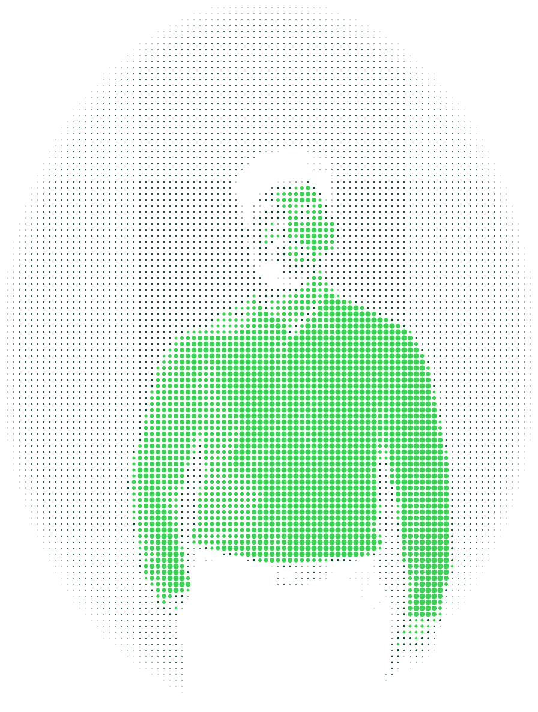
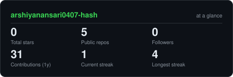
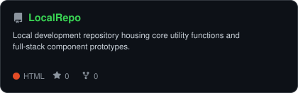

<div align="center">

<!-- PORTRAIT - generated by scripts/dotify.py from assets/jacket.png.
     Colour mode, so one file serves both GitHub themes. Regenerate with:
       python scripts/dotify.py assets/jacket.png -o assets/portrait \
         --cols 100 --equalize --detail 0.5 --color -->


<br>

<!-- NAME / TAGLINE - animated typing -->
<a href="https://github.com/arshiyanansari0407-hash">

  
</a>

<br>

<!-- SOCIALS -->
<a href="https://www.linkedin.com/in/arshiyan-ansari"></a>
<a href="arshiyanansari0407@gmail.com"></a>


</div>

---

## `` Who am I 

```console
Intro
```

Hi, I'm Arshiyan Ansari. Full-Stack Developer & Software Engineering specializing in the MERN stack, JavaScript/TypeScript and Python AI integration for web and mobile platforms.

- Role **Full-Stack Developer | Junior Software Developer**
- Experience **Completed a Software Engineering internship at 369innovation,contributing to full-stack web and mobile application development.**
- Backend Development **Built 15+ RESTful APIs using Node.js and Express.js, implementing JWT authentication, request validation, middleware, and API security.**
- Database & Security: **Worked with MongoDB, Mongoose, MySQL, authentication, and access control for 3 user roles.**
- AI Engineering **Developing my knowledge of Python, AI Engineering, LLM integration, and prompt engineering through coursework and practical learning.**
- Projects **Built a full-stack eCommerce and factory order management application featuring 13+ REST APIs and 9 responsive pages.**
- Teamwork **Collaborated with a 4-developer team and resolved 30+ application bugs.**
- Learning **Advanced MERN Architecture + AI Model Integration**
- Fun fact **I enjoy turning ideas into practical applications and continuously learning new technologies.**

<br>

<div align="center">

## Toolbox


</div>

---

<div align="center">

## Skill radar

<table>
<tr>
<td width="50%" align="center" valign="middle">

<!-- Self-rated radar - edit assets/skills.json, the workflow redraws it -->
<picture>
  <source media="(prefers-color-scheme: dark)"  srcset="assets/radar-dark.svg">
  <source media="(prefers-color-scheme: light)" srcset="assets/radar-light.svg">
  
</picture>

</td>
<td width="50%" align="center" valign="middle">

<!-- Live radar built from real language byte counts across your repos -->
<picture>
  <source media="(prefers-color-scheme: dark)"  srcset="assets/radar-langs-dark.svg">
  <source media="(prefers-color-scheme: light)" srcset="assets/radar-langs-light.svg">
  
</picture>

</td>
</tr>
</table>

</div>

---

<div align="center">

## Contribution calendar

<!-- 3D isometric calendar, regenerated every 6h by .github/workflows/metrics.yml -->


<br><br>

<!-- Snake eats the contribution graph - .github/workflows/snake.yml -->
<picture> 
  <source media="(prefers-color-scheme: dark)"  srcset="https://raw.githubusercontent.com/arshiyanansari0407-hash/arshiyanansari0407-hash/output/snake-dark.svg">
  <source media="(prefers-color-scheme: light)" srcset="https://raw.githubusercontent.com/arshiyanansari0407-hash/arshiyanansari0407-hash/output/snake.svg">
  
</picture>

</div>

---

<div align="center">

## The numbers

<!-- Generated by scripts/cards.py into this repo. Deliberately NOT
     github-readme-stats / streak-stats / github-profile-trophy: those are
     shared public instances that go down and take the whole section with them. -->
<picture>
  <source media="(prefers-color-scheme: dark)"  srcset="assets/card-stats-dark.svg">
  <source media="(prefers-color-scheme: light)" srcset="assets/card-stats-light.svg">
  
</picture>

<br>


<br><br>
<!--

-->
</div>

---

<div align="center">

## Selected work

<!-- Cards generated by scripts/cards.py from assets/projects.json.
     Stars, forks and language are pulled live from the API on every run. -->
<table>
<tr>
<td width="50%">
  <a href="https://github.com/arshiyanansari0407-hash/Plywood-Fullstack">
    <picture>
      <source media="(prefers-color-scheme: dark)"  srcset="assets/card-TradingBot-dark.svg">
      <source media="(prefers-color-scheme: light)" srcset="assets/card-TradingBot-light.svg">
      
    </picture>
  </a>
</td>
<td width="50%">
  <a href="https://github.com/arshiyanansari0407-hash/TradingBot">
    <picture>
      <source media="(prefers-color-scheme: dark)"  srcset="assets/card-LocalRepo-dark.svg">
      <source media="(prefers-color-scheme: light)" srcset="assets/card-LocalRepo-light.svg">
      
    </picture>
  </a>
</td>
</tr>
<tr>
<!--
<td width="50%">
  <a href="https://github.com/arshiyanansari0407-hash/Socrates">
    <picture>
      <source media="(prefers-color-scheme: dark)"  srcset="assets/card-Socrates-dark.svg">
      <source media="(prefers-color-scheme: light)" srcset="assets/card-Socrates-light.svg">
      
    </picture>
  </a>
</td>
<td width="50%">
  <a href="https://github.com/arshiyanansari0407-hash/humanOS">
    <picture>
      <source media="(prefers-color-scheme: dark)"  srcset="assets/card-humanOS-dark.svg">
      <source media="(prefers-color-scheme: light)" srcset="assets/card-humanOS-light.svg">
      
    </picture>
  </a>
</td>
</tr>-->
</table>

<sub>
<
| project | live | stack |
|---|---|---|
| **[Plywood Fullstack](https://github.com/arshiyanansari0407-hash/Plywood-Fullstack)** | [sage-calendar.vercel.app](https://plywood-fullstack.vercel.app/) | `JavaScript` `React` `Node.js` `Express` `MongoDB` |
| **[TradingBot](https://github.com/arshiyanansari0407-hash/TradingBot)**  | `Python` `AI` `Trading` |
<
</sub>

</div>
